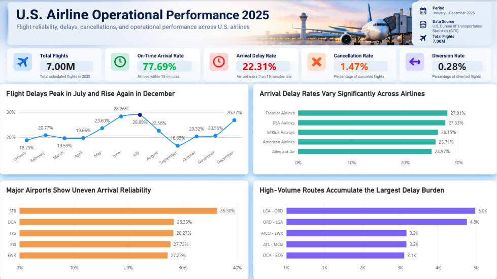
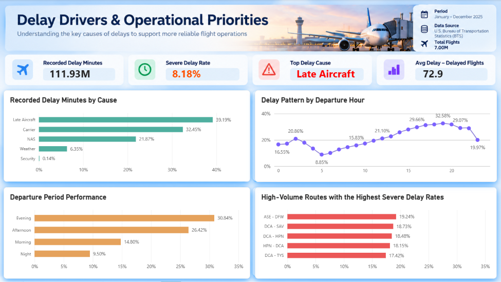

# U.S. Airline Operational Performance Analytics 2025

A portfolio project analyzing U.S. airline operational performance in 2025 using **Python, PostgreSQL, SQL, and Power BI**.

The project focuses on flight reliability, arrival delays, cancellations, delay causes, airline performance, airport performance, and high-impact routes.

---

## Project Overview

The dataset contains approximately **7.0 million U.S. flight records** from 2025.

The workflow covers:

1. Data preprocessing and validation with Python
2. Exploratory data analysis
3. Data enrichment and database preparation
4. PostgreSQL data loading
5. SQL business analysis
6. Power BI dashboard development
7. Business insights and recommendations

The main goal is to identify **when delays happen, where operational performance is weaker, and which delay drivers should receive the most attention**.

---

## Business Questions

This project answers several practical questions:

- How reliable were U.S. airline operations in 2025?
- Which months had the highest arrival delay rates?
- Which airlines and airports showed weaker arrival reliability?
- What were the main recorded causes of delay?
- How did delay risk change throughout the day?
- Which routes created the largest delay burden or severe-delay exposure?

---

## Tech Stack

- **Python:** Pandas, data cleaning, preprocessing, EDA
- **PostgreSQL:** data warehouse and analytical storage
- **SQL:** KPI calculation, aggregation, business analysis, analytical views
- **Power BI:** dashboard development and data visualization
- **VS Code / Jupyter Notebook:** project development

---

## Project Workflow

```text
Raw BTS Flight Data
        |
        v
Python Preprocessing
        |
        v
Exploratory Data Analysis
        |
        v
Data Enrichment
        |
        v
PostgreSQL Database
        |
        v
SQL Business Analysis
        |
        v
Power BI Dashboard
```

The PostgreSQL database contains:

- `dim_date`
- `dim_airline`
- `dim_airport`
- `fact_flights`

Final fact table size:

**7,001,619 flight records**

---

## Dashboard

### Page 1 — Operational Overview

Focuses on overall operational reliability, monthly delay trends, airline performance, airport performance, and high-impact routes.



### Page 2 — Delay Drivers

Focuses on recorded delay causes, severe delays, departure-hour patterns, departure-period performance, and high-risk routes.



---

## Key Findings

### 1. Overall airline reliability

- Total scheduled flights: **7.00M**
- On-time arrival rate: **77.69%**
- Arrival delay rate: **22.31%**
- Cancellation rate: **1.47%**
- Diversion rate: **0.28%**

### 2. Delay rates changed significantly across the year

Arrival delay rate reached its highest level in **July at 28.89%**.

It fell to approximately **16.63% in September**, before increasing again to **26.77% in December**.

### 3. Airline performance varied noticeably

Among the airlines with the highest arrival delay rates:

- Frontier Airlines: **27.91%**
- PSA Airlines: **27.53%**
- JetBlue Airways: **26.15%**
- American Airlines: **25.71%**
- Allegiant Air: **24.97%**

### 4. Some airports had significantly weaker arrival reliability

Among destination airports with at least 10,000 arriving flights, **SFB recorded the highest arrival delay rate at approximately 36.30%**.

### 5. Late Aircraft was the largest recorded delay driver

Recorded delay minutes were approximately **111.93M**.

Delay contribution by cause:

- Late Aircraft: **39.19%**
- Carrier: **32.45%**
- NAS: **21.87%**
- Weather: **6.35%**
- Security: **0.14%**

Late Aircraft and Carrier causes together accounted for approximately **71.64% of recorded delay minutes**.

### 6. Delay risk increased later in the day

Arrival delay rate by departure period:

- Evening: **30.84%**
- Afternoon: **26.42%**
- Morning: **14.80%**
- Night: **9.50%**

This indicates that delays became more common later in the operating day.

### 7. Route impact and route severity were not always the same

Routes such as **LGA–ORD** and **ORD–LGA** generated some of the largest total delay burdens, while other routes ranked higher when evaluated using severe delay rate.

This shows why operational prioritization should consider both **delay rate and total traffic impact**.

---

## Business Recommendations

- **Improve aircraft turnaround and recovery planning** because Late Aircraft and Carrier delays represent the majority of recorded delay minutes.
- **Add more operational buffer during afternoon and evening periods**, when arrival delay rates are much higher.
- **Prepare additional recovery capacity for July and December**, when delay rates rise significantly.
- **Investigate high-delay airports separately**, especially airports that consistently perform worse despite meaningful traffic volume.
- **Prioritize routes using both rate and impact**, rather than focusing only on the highest delay percentage.

---

## Limitations

This project is designed as a descriptive operational analytics portfolio project.

Main limitations:

- The analysis covers **2025 only**, so it does not compare performance against previous years.
- The analysis identifies patterns and associations, but it does **not prove causation**.
- External factors such as detailed weather conditions, air traffic restrictions, staffing, aircraft type, and airport congestion were not added as separate external datasets.
- Recorded delay-cause minutes represent reported delay categories and should not be interpreted as a complete causal model of every delayed flight.
- The Power BI dashboard uses aggregated PostgreSQL views for performance. Because the views are standalone, the dashboard does not use a single global slicer across every visual.
- Raw and processed datasets are excluded from the public repository because of their size.

---

## Repository Structure

```text
us-airline-operational-performance-analytics/
|
├── Dashboards/
│   ├── Page1_OperationalOverview.png
│   ├── Page2_DelayDrivers.png
│   └── US_Airlines_Operational_Performance_2025.pbix
|
├── data/
│   ├── raw/
│   ├── processed/
│   ├── analysis/
│   └── database/
|
├── notebooks/
│   ├── 01_data_preprocessing_airline_2025.ipynb
│   ├── 02_exploratory_data_analysis_airline_2025.ipynb
│   ├── 03_data_enrichment_and_database_export_airline_2025.ipynb
│   └── 04_load_postgresql_airline_2025.ipynb
|
├── sql/
│   ├── 00_create_schema_airline_2025.sql
│   └── 05_sql_business_analysis_airline_2025.sql
|
└── README.md
```

---

## How to Run

1. Prepare the 2025 flight data inside data/raw/.
2. Run notebooks 01 to 03.
3. Create the PostgreSQL database airline_analytics_2025.
4. Run sql/00_create_schema_airline_2025.sql.
5. Run 04_load_postgresql_airline_2025.ipynb.
6. Run sql/05_sql_business_analysis_airline_2025.sql.
7. Open the Power BI file inside Dashboards/.
8. Refresh the PostgreSQL connection if needed.

---

## Data Source

U.S. airline on-time performance data from the **U.S. Bureau of Transportation Statistics (BTS)** for 2025.

---

## Author

**Khairu Ikramendra**

Data Analyst portfolio project focused on end-to-end analytics using Python, SQL, PostgreSQL, and Power BI.